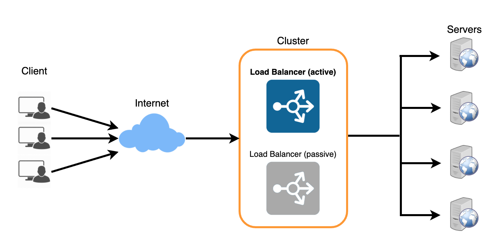
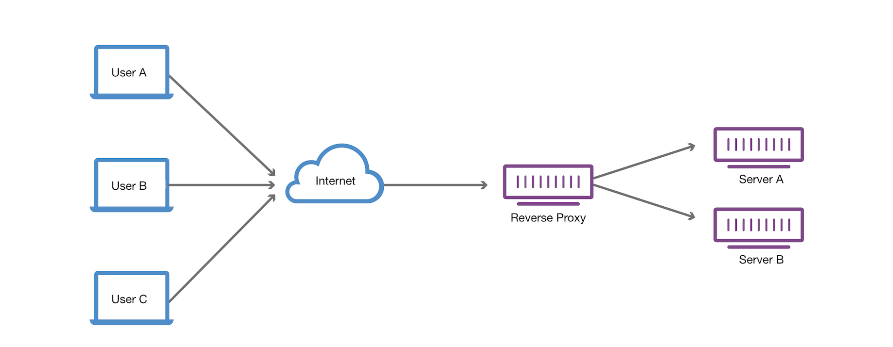
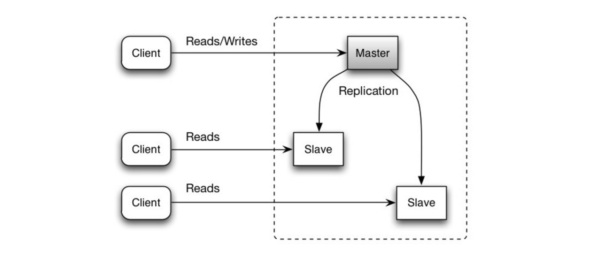
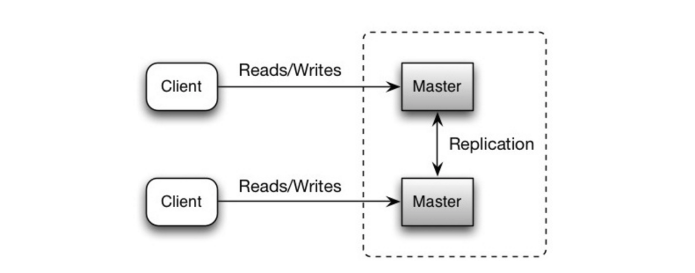
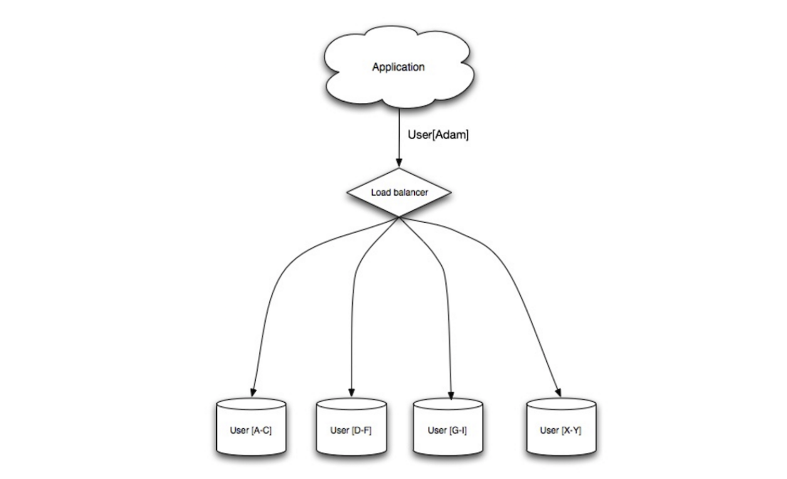

## A request

A request crosses the same boxes almost every time.

1. **DNS** turns the name into an address. See [Networking](#networking).
2. A **reverse proxy** or a CDN terminates TLS and may answer from a cache. See [Reverse proxy](#reverse-proxy).
3. A **load balancer** picks a healthy instance. See [Load balancer](#load-balancer).
4. The **application** handles the request. An expensive answer is checked in a [cache](#cache) first.
5. The **database** is where the data lives. A read can hit a replica that is a moment behind. See [CAP](#cap) and [Databases](#databases).

Work the user does not have to watch — a mail send, a resize, a fan-out — waits on a queue instead of on this path. See [Sync and a queue](#sync-queue).

## Networking

**DNS**  
A name such as `api.example.com` is a lookup, and the answer is an address. Clients cache it for the TTL, so changing the address is not instant. One name can return several addresses. That rotation is a crude load balancer: it cannot see which server is down.

**TCP and UDP**  
TCP is a connection. Bytes arrive in order, and a lost packet is sent again. HTTP, database clients, and most service calls sit on it. UDP sends a datagram and does not retry. DNS queries use it, and so does some real-time media, because a late packet is worse than a missing one.

**HTTP**  
A request is a method, a path, and headers. The response is a status and a body. GET and PUT are safe to send again. POST is not, unless the server recognises a duplicate. 2xx means it worked, 4xx means the client was wrong, 5xx means the server was. Underneath, the connection is usually TCP, and keep-alive reuses it instead of opening another. How a Node process spends that connection is in [HTTP performance](/nodejs#http-performance).

**TLS**  
The handshake checks the server's certificate and agrees a key. After that the bytes are encrypted. End the handshake at the reverse proxy when the network behind it is yours. Otherwise carry TLS through to the process.

## Scalability

Scalability is how many requests the system can serve at once before it gets slow or fails.

### Vertical scaling

Add CPU, memory, or faster disk to the machine you already have. The data stays on one box, so it stays consistent, and nothing has to spread traffic.
  

- One machine is a single point of failure
- There is a limit to how far one box grows, and the last upgrades are the expensive ones

A single process is this shape. When the box is not enough, run more of them. See [Scaling services](/nodejs#scaling-services).

### Horizontal scaling

Add machines, and give each a share of the work. One failure takes out a share, not the service. The cost is the network between them, and something has to decide which machine gets the next request.
  
Three ways to get there:

- **Caching:** keep a hot answer close, so the next request skips the slow path. See [Cache](#cache).
- **Load balancing:** one address in front, many servers behind. See [Load balancer](#load-balancer).
- **Splitting the data:** copy it so reads scale, or partition it so no single database holds everything. See [Databases](#databases).

## Sync and a queue

A synchronous call means the caller waits. Use it when the user is waiting for that answer: reading their own data, or a payment that has to succeed before the page says it did. Give the call a timeout shorter than the caller's own timeout, or one slow dependency holds every request behind it. A retry on that path multiplies the load. How a Node client does this is in [Resilience](/nodejs#resilience-patterns).
  
A queue means the caller hands the work off and continues. Use it when the user does not have to watch: mail, a resize, a fan-out. The worker retries, and a message that keeps failing goes to a dead-letter queue instead of blocking the request. The cost is that the page can say "done" before the work is. Running that worker is in [Background jobs](/nodejs#background-jobs).

## Load balancer

A load balancer sits between clients and servers. It picks a server for each request and stops sending traffic to one that fails a health check. A check is a regular connection attempt. A server that stops answering leaves the pool until it answers again.
  
One balancer is itself a single point of failure. Run a second that watches the first and takes over.

How it chooses a server:

- **Least connections:** the server with the fewest open connections. Fits long-lived connections that pile up unevenly.
- **Least response time:** fewest connections, and the fastest recent responses.
- **Least bandwidth:** the server currently moving the least traffic.
- **Round robin:** the next server in the list. Fine when the servers match and connections are short.
- **Weighted round robin:** the same cycle, with a stronger server appearing more often.
- **IP hash:** hash the client address so the same client keeps landing on the same server. That is what a sticky session does. See [Scaling services](/nodejs#scaling-services).

Where it sits:

- **DNS:** one name, many addresses, rotated as answers come in. Easy to set up, and the addresses can point at a nearby region. DNS cannot see load or a dead server, and clients keep a cached answer until the TTL runs out, so a change is not instant. Each server needs a public address.
- **Bridged:** a virtual address on the same network as the servers. No new subnet, and it stays on that one network. A careless layout loops at layer 2.
- **Routed:** the virtual address is on a different network from the servers, so the servers can live in more than one place. That needs the extra network, and it costs more.
- **Network load balancing:** a cluster of machines, each with its own name and address, agreeing on who answers. A down host is skipped. The machines share a subnet, and a check that only looks at the network can still send a user to a process that is up but not serving.

## Reverse proxy

A reverse proxy sits in front of the servers. It takes the client's request, forwards it to a server that can answer, and returns that response. The client never talks to the origin.
  
A forward proxy sits in front of the client and hides the client from the servers. A reverse proxy hides the servers from the client.
  
Use one to terminate TLS, cache a response, and keep the origin off the public internet. A CDN is a reverse proxy with copies close to the user.

## Cache

A cache holds a copy of something expensive, so the next read skips the slow path. The hard part is knowing when the copy is stale. How an application does that is in [Caching](/nodejs#caching).
  

- **Memcached:** string keys and values, in memory, up to 1 MB a key. Nothing is written to disk. A node that dies takes its keys with it.
- **Redis:** an in-memory dictionary, with values up to 512 MB and structures beyond a plain string. It can persist a snapshot or an append-only log. Pub/sub fans one message out to many subscribers.
- **Hazelcast:** an in-memory grid. Copies of an entry sit on more than one node, so one node dying does not lose it. Add nodes to grow it.
- **Couchbase:** a document store. The data is kept on disk as well as in memory.

## CAP

A distributed store is described by three properties, and during a network split it keeps two:

- **Consistency:** a read sees the latest write
- **Availability:** a request gets an answer, even if the answer is stale
- **Partition tolerance:** the store keeps running when nodes cannot reach each other

Splits happen, so the choice that matters is consistency or availability. A primary that refuses a write when it cannot reach a quorum chose consistency. A replica that serves a row from a moment ago chose availability. That gap is replication lag. A flow that must read what it just wrote either reads the primary, or waits until the replica has caught up. BASE, in the NoSQL notes, is the availability side of this.

## Databases

### Relational databases

A relational database stores rows in tables and answers with SQL. A transaction is ACID:

- **Atomicity:** every statement in the transaction commits, or none of them do
- **Consistency:** the database still obeys its rules afterwards
- **Isolation:** concurrent transactions leave the same result as if they had run one after another
- **Durability:** a committed write survives a crash

One database grows by copying it, splitting it, or writing the data in the shape the reads want.

#### Master-slave replication

The master takes writes and copies them to slaves that only serve reads. A slave can copy onward to further slaves. If the master dies, reads continue until a slave is promoted.

- Promoting a slave is extra logic, and it is not instant
- A write that has not been copied yet is lost with the master
- A heavy write load clogs the replicas, and more replicas means more lag

#### Master-master replication

Both masters take reads and writes, and they sync writes with each other. If one dies, the other keeps serving both.

- Something has to choose where a write goes
- Staying consistent costs write latency. Loosening that breaks ACID
- Two writes to the same row conflict, and that gets worse as nodes and latency grow

#### Federation

Split by function. Users in one database, products in another, instead of one database that holds everything. Each one takes less traffic, so more of it fits in memory, and writes are no longer queued behind a single master.
  

- The application has to know which database to call
- A join across two of them is a query across servers
- A schema that is one giant table does not split this way

#### Sharding

Split by a key, such as a user id or a region. Each shard holds a slice, and a new shard is how the cluster grows. One shard down leaves the others up, so replicate the shard if losing that slice is unacceptable. Indexes stay small, and writes on different shards run at the same time.

- A query without the shard key fans out to every shard
- A lopsided key puts the load on one shard. Rebalancing means moving rows
- A join across shards is application code

#### Denormalization

Copy a value into the table that reads it, so the read skips a join. Reads often outnumber writes by 100:1 or more, and a join that hits disk dominates that read. PostgreSQL and Oracle can keep the copy up to date in a materialized view.
  
In a normalized schema a `courses` row stores a `teacherID`, and the name lives on `teachers`. Listing courses with the teacher's name is a join, and a renamed teacher is one update. Denormalized, the name is copied onto the course, and a rename is a write to every copy.
  

- The copies can drift. A constraint that keeps them honest is more schema
- A write-heavy table can get slower, because every write touches the copies

### SQL tuning

Measure before changing anything. A load generator such as `ab` shows whether the database is the bottleneck. The slow query log shows which statement it is.
  

- **Schema:** CHAR for a fixed length, TEXT for a long body, INT for a whole number up to about 4 billion, DECIMAL for money so it is not a float. Keep a large blob outside the row and store the location. NOT NULL lets the planner skip a check.
- **Indexes:** index the columns you filter, sort, and join on. The usual structure is a B-tree, so a lookup is logarithmic. The index takes memory, and every write updates it too. For a bulk load, drop the indexes, load, then rebuild them.
- **Joins:** when a join is the slow part, denormalize that read.
- **Hot rows:** move the busy slice into its own table so it stays in memory.
- **Query cache:** a cache of plans helps some workloads and thrashes others. Check it against the queries you actually run.

The same rules, from the application side, are in [Data access](/nodejs#data-access).

### NoSQL

Key-value, document, wide column, or graph. The data is stored in the shape it is read, and joins happen in the application. Most of these give up ACID for availability.
  
BASE is the usual description. Next to [CAP](#cap), it picks availability over a fresh read:

- **Basically available:** the store answers
- **Soft state:** replicas can still be catching up, so a read can change without a new write
- **Eventual consistency:** given a quiet period, the replicas agree

#### Key-value store

A hash table, in memory or on disk. One unique key, one value, read and written in O(1). Keys kept in order make a range scan possible.
  
Redis adds data structures, and it can persist an append-only log or a snapshot. Memcached is the plain version: memory only, and a restart drops it. Use either for a cache, a session, a preference, or a short queue. Anything that relates two values is the application's job.

#### Document store

The value is a document, usually JSON. A collection groups them, the fields inside can be queried, and two documents in the same collection do not have to share a shape.
  
MongoDB indexes those fields and shards the collection. CouchDB speaks HTTP, keeps old versions, and replicates in both directions. Elasticsearch indexes the text for search. The cost is the indexes: a query without one scans, and a document that changes shape makes the index a thing you have to tend.
